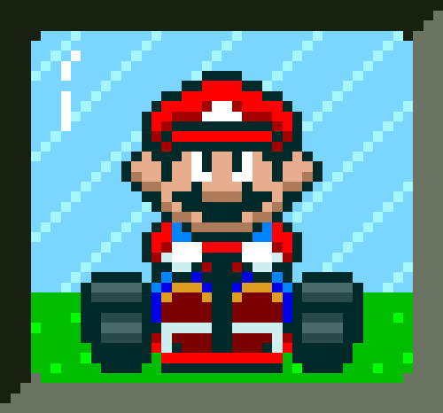
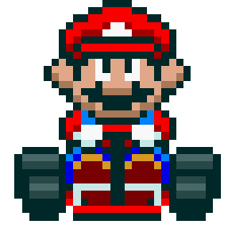
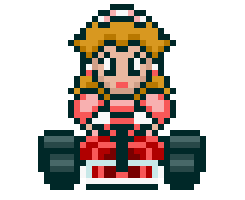
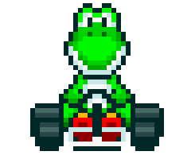
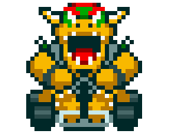
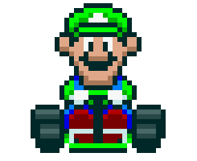
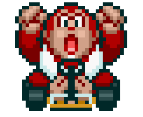

<h1>🏎️ Simulador de Corridas do Mario Kart — Node.js</h1>

<table>
  <tr>
    <td>
      
    </td>
    <td>
      <b>Sobre o projeto:</b>
      <p>Simulador de corridas inspirado no Mario Kart, escrito em Node.js puro (sem dependências externas). A cada rodada o jogo sorteia um tipo de pista, rola os dados e soma os atributos dos personagens para decidir quem pontua — até declarar o vencedor da corrida.</p>
      <p>Projeto pensado para portfólio: código modularizado, documentado e com testes automatizados.</p>
    </td>
  </tr>
</table>

## ✨ Recursos

- 🎮 **Seleção interativa** de personagens e do número de rodadas pelo terminal (módulo nativo `readline`).
- 🧑‍🤝‍🧑 **Roster completo** com 6 personagens, cada um com atributos próprios.
- 🛣️🌀🥊 **Três tipos de bloco de pista**: reta, curva e confronto.
- 🐢💣 **Itens no confronto**: o perdedor leva um Casco (−1) ou uma Bomba (−2), sorteados.
- 🚀 **Turbo**: o vencedor do confronto pode ganhar +1 ponto.
- 🛡️ **Pontuação com piso em 0** — ninguém fica negativo.
- 📊 **Placar a cada rodada** e logs com emojis.
- 🧩 **Código modularizado** (`characters`, `engine`, `prompt`, `index`) com JSDoc.
- ✅ **Testes automatizados** com o runner nativo `node:test` e aleatoriedade injetável.
- ⌨️ **CLI**: `--rounds=N` para definir o número de rodadas sem interação.

## 🎮 Como executar

Pré-requisito: **Node.js 18+** (há um `.nvmrc` apontando para a 20).

```bash
# se usar nvm
nvm use

# rodar a corrida (modo interativo)
npm start

# definir o número de rodadas direto na linha de comando
node src/index.js --rounds=10

# rodar os testes
npm test
```

No modo interativo, escolha os dois personagens pelos números exibidos, informe quantas rodadas quer e acompanhe a corrida. Em terminal não-interativo, o jogo sorteia dois personagens e usa 5 rodadas por padrão.

## 🕹️ Regras & mecânicas

- A corrida tem **N rodadas** (padrão 5, configurável de 1 a 20).
- A cada rodada é sorteado um **bloco de pista**:
  - 🛣️ **RETA** → dado (1–6) **+ VELOCIDADE**. Quem somar mais ganha **+1 ponto**.
  - 🌀 **CURVA** → dado (1–6) **+ MANOBRABILIDADE**. Quem somar mais ganha **+1 ponto**.
  - 🥊 **CONFRONTO** → dado (1–6) **+ PODER**. O perdedor sofre a penalidade do item sorteado:
    - 🐢 **Casco** → −1 ponto
    - 💣 **Bomba** → −2 pontos
    - 🚀 O vencedor ainda pode pegar um **Turbo** (+1 ponto).
- Nenhum jogador pode ficar com pontuação **negativa**.
- Ao final, **vence quem acumulou mais pontos** (ou empate).

## 🧑‍🤝‍🧑 Personagens

<table style="border-collapse: collapse; width: 800px; margin: 0 auto;">
  <tr>
    <td style="border: 1px solid black; text-align: center;">
      <p>Mario</p>
      
    </td>
    <td style="border: 1px solid black; text-align: center;">
      <p>Velocidade: 4</p>
      <p>Manobrabilidade: 3</p>
      <p>Poder: 3</p>
    </td>
    <td style="border: 1px solid black; text-align: center;">
      <p>Peach</p>
      
    </td>
    <td style="border: 1px solid black; text-align: center;">
      <p>Velocidade: 3</p>
      <p>Manobrabilidade: 4</p>
      <p>Poder: 2</p>
    </td>
    <td style="border: 1px solid black; text-align: center;">
      <p>Yoshi</p>
      
    </td>
    <td style="border: 1px solid black; text-align: center;">
      <p>Velocidade: 2</p>
      <p>Manobrabilidade: 4</p>
      <p>Poder: 3</p>
    </td>
  </tr>
  <tr>
    <td style="border: 1px solid black; text-align: center;">
      <p>Bowser</p>
      
    </td>
    <td style="border: 1px solid black; text-align: center;">
      <p>Velocidade: 5</p>
      <p>Manobrabilidade: 2</p>
      <p>Poder: 5</p>
    </td>
    <td style="border: 1px solid black; text-align: center;">
      <p>Luigi</p>
      
    </td>
    <td style="border: 1px solid black; text-align: center;">
      <p>Velocidade: 3</p>
      <p>Manobrabilidade: 4</p>
      <p>Poder: 4</p>
    </td>
    <td style="border: 1px solid black; text-align: center;">
      <p>Donkey Kong</p>
      
    </td>
    <td style="border: 1px solid black; text-align: center;">
      <p>Velocidade: 2</p>
      <p>Manobrabilidade: 2</p>
      <p>Poder: 5</p>
    </td>
  </tr>
</table>

## 🗂️ Estrutura do projeto

```
├── docs/                # gifs dos personagens
├── src/
│   ├── characters.js    # roster e criação de personagens jogáveis
│   ├── engine.js        # motor da corrida (rodadas, blocos, itens, turbo)
│   ├── prompt.js        # seleção interativa via terminal (readline)
│   └── index.js         # ponto de entrada / orquestração
├── test/
│   └── engine.test.js   # testes automatizados (node:test)
├── .nvmrc               # versão do Node (20)
├── extras.md            # ideias de evolução
├── package.json
└── readme.md
```

## 🧪 Testes

Os testes usam o runner nativo do Node.js (`node:test`). Como a engine recebe a fonte de aleatoriedade por injeção (`rng`), os cenários ficam determinísticos e fáceis de validar:

```bash
npm test
```

## 📄 Licença

Distribuído sob a licença ISC. Mario Kart e seus personagens são propriedade da Nintendo; este é um projeto de estudo sem fins comerciais.
